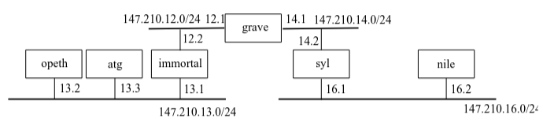

# TD 2

### RAPPEL ! eth0 -> gauche et eth1 -> droite
## Configuration de sous-réseaux

### Modifiez le fichier `/etc/network/interfaces` de chaque machine de manière à obtenir la configuration décrite dans la figure précédente.
opeth (idem pour atg et nile):
```bash
# The loopback network interface
auto lo
iface lo inet loopback

# The primary network interface
auto eth0 
iface eth0 inet static
    address 147.210.13.2/24
```

immortal (idem pour grave et syl):
```bash
# The loopback network interface
auto lo
iface lo inet loopback

# The primary network interface
auto eth0
iface eth0 inet static
        address 147.210.13.1/24

auto eth1
iface eth1 inet static
        address 147.210.12.2/24
```

### Configuration des tables de routage

#### /!\ la gateway est vers la machine connecté a celle qui a les post-up

opeth (idem pour atg et nile):
```bash
# The loopback network interface
auto lo
iface lo inet loopback

# The primary network interface
auto eth0 
iface eth0 inet static
    address 147.210.13.2/24
    gateway 147.210.13.1
```

#### /!\ ici la gateway est vers le routeur

immortal (idem pour syl):
```bash
# The loopback network interface
auto lo
iface lo inet loopback

# The primary network interface
auto eth0
iface eth0 inet static
        address 147.210.13.1/24

auto eth1
iface eth1 inet static
        address 147.210.12.2/24
        gateway 147.210.12.1
```

grave :
```bash
# The loopback network interface
auto lo
iface lo inet loopback

# The primary network interface
auto eth0
iface eth0 inet static
        address 147.210.12.1/24
        post-up ip route add 147.210.13.0/24 via 147.210.12.2

auto eth1
iface eth1 inet static
        address 147.210.14.1/24
        post-up ip route add 147.210.16.0/24 via 147.210.14.2
```

### Pour que ça marche, il faut faire une manip de plus
`nano /etc/sysctl.d/forward.conf`
```bash
net.ipv4.ip_forward=1
```
`systemctl restart systemd-sysctl`