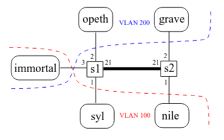
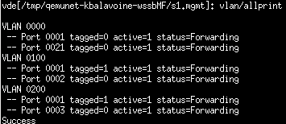

# TD 4


## Premiers pas

`nano /etc/network/interfaces`

### 1) Configurer syl et opeth de telle sorte qu’elles soient dans deux réseaux IP différents.
`opeth -> 172.16.0.2/24`<br>
`syl -> 172.16.1.2/24`

### 2) Configuration immortal.
**immortal**
```bash
#VLAN 100
auto eth0.100
iface eth0.100 inet static
        address 172.16.1.1
        netmask 255.255.255.0
vlan-raw-device eth0

#VLAN 200
auto eth0.200
iface eth0.200 inet static
        address 172.16.0.1
        netmask 255.255.255.0
vlan-raw-device eth0
```

#### n'oublions pas :
**immortal**<br>
`nano /etc/sysctl.d/forward.conf`
```bash
net.ipv4.ip_forward=1
```
`systemctl restart systemd-sysctl`

### 3) Configurer syl et opeth de telle sorte qu’immortal soit leur passerelle.
Il faut pointer les gateway sur immortal.

### 4) Configuration VLAN de s1 :
**s1**<br>
`vlan/create 100`<br>
`vlan/addport 100 3`<br>
`port/setvlan 1 100`<br>

`vlan/create 200`<br>
`vlan/addport 200 3`<br>
`port/setvlan 2 200`<br>



## Configuration avancée

### 1) Configuration de nile et grave
`opeth -> 172.16.0.2/24`<br>
`syl -> 172.16.1.2/24`<br>
gateway vers immortal

### 2) Configuration de s2
**s2**<br>
`vlan/create 100`<br>
`port/setvlan 1 100`<br>

`vlan/create 200`<br>
`port/setvlan 2 200`<br>

### 3) relier s1 à s2
**s1**<br>
`vlan/addport 100 21`<br>
`vlan/addport 200 21`<br>

**s2**<br>
`vlan/addport 100 21`<br>
`vlan/addport 200 21`<br>
