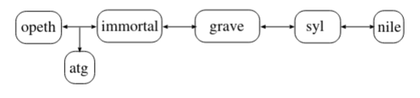

# TD 5


## 1) Configuration des adresses dans un réseau local

### Configurez les trois machines pour qu’elles aient 3 adresses IPv6 différentes dans le réseau 2001:db8:0:f101::0/64:

**opeth** (idem pour immortal (2) et atg (3))
```bash
auto eth0
iface eth0 inet6 static
        address 2001:db8:0:f101::1/64

```

### adressage de syl

**syl**
```bash
auto eth0
iface eth0 inet6 static
        address 2001:db8:0:f102::1/64
```

### configurer le serveur radvd sur syl (ce serveur sert à donner les éléments nécessaire à la configuration).

**syl**<br>

`nano /etc/radvd.conf`
```bash
interface eth1
{
    AdvSendAdvert on;
    prefix 2001:db8:0:f102::0/64
    {
        AdvOnLink on;
        AdvAutonomous on;
        AdvRouterAddr on;
    };
    route ::/0 {};
};
```
`service radvd restart`

### sur nile, configurer le service réseau via le fichier /etc/network/interfaces de la manière suivante:

**nile**
```bash
auto eth0
iface eth0 inet6 auto
```

## 2) Configuration des autres machines et du routage

