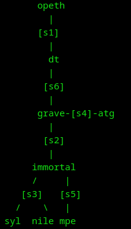

# TD 6


## NAT

### rajoutez les règles NAT pour que la passerelle immortal (resp. dt) fasse les associations adresse publique/adresse privée de telle sorte que mpe (resp. opeth) puisse communiquer avec le reste des machines

**immortal**<br>
`nano script.sh`
```bash
#!/bin/sh
iptables -t nat -F

iptables -t nat -A POSTROUTING -s 192.168.1.2 -j SNAT --to-source 147.210.20.2
iptables -t nat -A PREROUTING -d 147.210.20.2 -j DNAT --to-destination 192.168.1.2
```
`sh script.sh`

**dt**<br>
`nano script.sh`
```bash
#!/bin/sh
iptables -t nat -F

iptables -t nat -A POSTROUTING -s 172.16.0.2 -j SNAT --to-source 140.77.13.2
iptables -t nat -A PREROUTING -d 140.77.13.2 -j DNAT --to-destination 172.16.0.2
```
`sh script.sh`

### afficher les règles iptables actives
`iptables -t nat -L -n -v`

### Rajoutez des règles de masquerading au niveau de la passerelle immortal pour qu’une translation d’adresses dynamique soit effective pour le réseau 192.168.0.0/24. Faire en sorte que le port 22 de syl soit accessible depuis les autres machines.
**immortal**
```bash
#!/bin/sh
iptables -t nat -F

iptables -t nat -A POSTROUTING -o eth0 -s 192.168.0.0/24 -j MASQUERADE
iptables -t nat -A PREROUTING -d 147.210.20.2 -p tcp --dport 22 -j DNAT --to 192.168.0.2:22
```