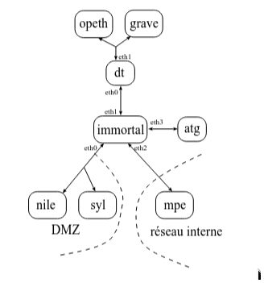

# TD 7



### 1) Faire en sorte que le firewall filtre (bloque) le traffic ICMP vers les machines de la DMZ.

**immortal**<br>
`nano script.sh`

```bash
#!/bin/sh
iptables -F

iptables -A FORWARD -p icmp -d 192.168.0.0/24 -j DROP
```

### 2) Essayez maintenant de pinguer opeth depuis syl. Commentez et corrigez.

le ping ne reviens pas

**immortal**

```bash
#!/bin/sh
iptables -F

iptables -A FORWARD -d 192.168.0.0/24 -p icmp --icmp-type echo-reply -j ACCEPT
iptables -A FORWARD -p icmp -d 192.168.0.0/24 -j DROP
```

### 3) Mettre en place une politique par défaut qui interdit tout.

**immortal**

```bash
#!/bin/sh
iptables -F
iptables -P FORWARD DROP
...
```

### 4) Ajouter des règles iptables pour n’autoriser que le traffic sortant du réseau interne vers des serveur http ou ssh. Testez.

**immortal**

```bash
...
iptables -A FORWARD -s 192.168.1.0/24 -p tcp -m multiport --dport 80,22 -m state --state NEW_ESTABLISHED -j ACCEPT
iptables -A FORWARD -d 192.168.1.0/24 -p tcp -m multiport --sport 80,22 -m state --state ESTABLISHED -j ACCEPT
```

### 5) Ajouter des règles iptables pour que seul les services http et ftp de syl soient accessibles depuis les autres machines.

**immortal**

```bash
...
iptables -A FORWARD -d 192.168.0.2 -p tcp -m multiport --dport 80,20,21 -j ACCEPT
```

### 6) Ajouter des règles iptables pour que le service ssh de nile puisse être accessible. Raffiner la solution pour faire en sorte que le port 22 de nile ne puisse ếtre accessible que depuis atg.

**immortal**

```bash
...
iptables -A FORWARD -p tcp -s 91.160.100.2 -d 192.168.0.3 --dport 22 -j ACCEPT
```

### 7) Ajouter des règles iptables pour que la machine nile puisse accéder aux machines du réseau interne via ssh.

**immortal**

```bash
#!/bin/sh
iptables -F
iptables -P FORWARD DROP

iptables -A FORWARD -s 192.168.1.0/24 -p tcp -m multiport --dport 80,22 -n state --state NEW_ESTABLISHED -j ACCEPT
iptables -A FORWARD -d 192.168.1.0/24 -p tcp -m multiport --sport 80,22 -n state --state ESTABLISHED -j ACCEPT

iptables -A FORWARD -p tcp -d 192.168.0.2 -p tcp -m multiport --dport 80,20,21 -j ACCEPT
iptables -A FORWARD -p tcp -s 91.160.100.2 -d 192.168.0.3 --dport 22 -j ACCEPT
iptables -A FORWARD -p tcp -s 192.168.0.3 -d 192.168.1.2 --dport 22 -j ACCEPT
iptables -A FORWARD -m state --state RELATED,ESTABLISHED -j ACCEPT
```

### 8) Ajouter des règles iptables pour que les ports http et ftp de nile soient accessibles depuis les machines du réseau interne.

**immortal**

```bash
#!/bin/sh
iptables -F
iptables -P FORWARD DROP

iptables -A FORWARD -s 192.168.1.0/24 -p tcp -m multiport --dport 80,22 -n state --state NEW_ESTABLISHED -j ACCEPT
iptables -A FORWARD -d 192.168.1.0/24 -p tcp -m multiport --sport 80,22 -n state --state ESTABLISHED -j ACCEPT

iptables -A FORWARD -p tcp -d 192.168.0.2 -p tcp -m multiport --dport 80,20,21 -j ACCEPT
iptables -A FORWARD -s 192.168.1.0/24 -d 192.168.0.3 -p tcp -m multiport --dports 80,20,21 -j ACCEPT
iptables -A FORWARD -p tcp -s 91.160.100.2 -d 192.168.0.3 --dport 22 -j ACCEPT
iptables -A FORWARD -p tcp -s 192.168.0.3 -d 192.168.1.2 --dport 22 -j ACCEPT
iptables -A FORWARD -m state --state RELATED,ESTABLISHED -j ACCEPT
```

### 9) Ajouter des règles qui font en sorte qu’immortal n’accepte que 5 ouverture de connexion par minute sur le serveur ssh de nile.

**immortal**

```bash
#!/bin/sh
iptables -F
iptables -P FORWARD DROP

iptables -A FORWARD -s 192.168.1.0/24 -p tcp -m multiport --dport 80,22 -n state --state NEW_ESTABLISHED -j ACCEPT
iptables -A FORWARD -d 192.168.1.0/24 -p tcp -m multiport --sport 80,22 -n state --state ESTABLISHED -j ACCEPT

iptables -A FORWARD -p tcp -d 192.168.0.2 -p tcp -m multiport --dport 80,20,21 -j ACCEPT
iptables -A FORWARD -s 192.168.1.0/24 -d 192.168.0.3 -p tcp -m multiport --dports 80,20,21 -j ACCEPT
iptables -A FORWARD -p tcp -s 91.160.100.2 -d 192.168.0.3 --dport 22 -j ACCEPT
iptables -A FORWARD -p tcp -s 192.168.0.3 -d 192.168.1.2 --dport 22 -j ACCEPT
iptables -A FORWARD -p tcp -d 192.168.0.3 --dport 22 --syn -m limit --limit 5/minute --limit-burst 5 -j ACCEPT
iptables -A FORWARD -m state --state RELATED,ESTABLISHED -j ACCEPT
```

### 10) Mettre en place un mécanisme de traces (logs) qui permet d’avoir un historique de tous les paquets rejetés (DROP/REJECT) au niveau du pare-feu.

**immortal**

```bash
#!/bin/sh
iptables -F
iptables -P FORWARD DROP

iptables -A FORWARD -s 192.168.1.0/24 -p tcp -m multiport --dport 80,22 -n state --state NEW_ESTABLISHED -j ACCEPT
iptables -A FORWARD -d 192.168.1.0/24 -p tcp -m multiport --sport 80,22 -n state --state ESTABLISHED -j ACCEPT

iptables -A FORWARD -p tcp -d 192.168.0.2 -p tcp -m multiport --dport 80,20,21 -j ACCEPT
iptables -A FORWARD -s 192.168.1.0/24 -d 192.168.0.3 -p tcp -m multiport --dports 80,20,21 -j ACCEPT
iptables -A FORWARD -p tcp -s 91.160.100.2 -d 192.168.0.3 --dport 22 -j ACCEPT
iptables -A FORWARD -p tcp -s 192.168.0.3 -d 192.168.1.2 --dport 22 -j ACCEPT
iptables -A FORWARD -p tcp -d 192.168.0.3 --dport 22 --syn -m limit --limit 5/minute --limit-burst 5 -j ACCEPT
iptables -A FORWARD -m state --state RELATED,ESTABLISHED -j ACCEPT
iptables -A FORWARD -j LOG --log-prefix "FIREWALL_REJECT: " --log-level 4
```

### 11) l’aide de la commande nmap, testez l’efficacit´e de votre pare-feu.

**immortal**

```bash
Test de la politique par défaut (DROP)
nmap -p 445 192.168.0.3
=> 445/tcp filtered microsoft-ds

Test des accès autorisés (HTTP / SSH)
nmap -p 22,80 192.168.0.3
=> 22/tcp open ssh et 80/tcp open http

Test de la limitation (5 connexions / min)
nmap -p 22 --max-retries 0 -T5 192.168.0.3
=> Les 5 premières fois, le port sera open. À la 6ème, il passera en filtered ou mettra beaucoup de temps à répondre.

Test du FTP (Ports 20, 21)
nmap -p 21 192.168.0.3
=> 21/tcp open ftp

Vérification des Traces (Logs)
dmesg -w | grep "FIREWALL_REJECT"
=> À chaque fois que nmap teste un port interdit (comme le test n°1), une ligne s'affiche avec l'IP source, l'IP destination et le port bloqué.
```
