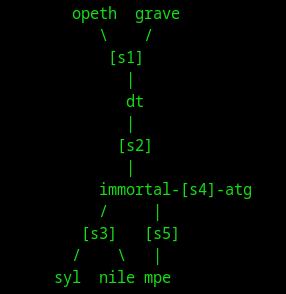
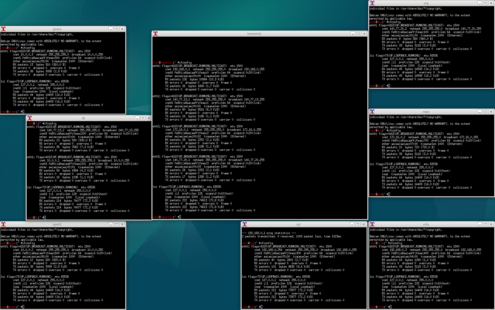
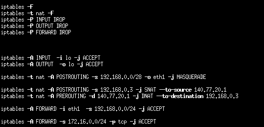
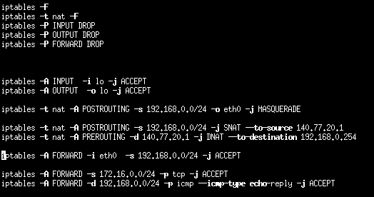
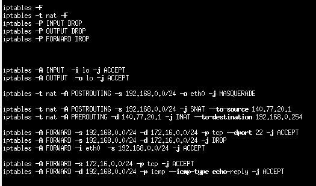

# TD 7 bis

## Il s'agit de lancer le script qemunet en lui fournissant l'archive disponible dans le dossier. Les consignes de l'exercice se trouvent dans le fichier /etc/init.d/ma-config.sh sur la machine immortal. Dans cet exercice, il vous est demandé de répondre aux questions et de réparer le script iptables /etc/init.d/ma-config.sh (disponible sur immortal). Seul ce script doit etre modifie.

### 1- Expliquer (en testant?) pourquoi le paquet envoye par la machine dont l'adresse IP est 192.168.0.254 vers la machine dont l'adresse IP est 10.0.0.2 ne peut pas arriver a destination. Corriger le probleme

 
On peut voir plusieurs problème :  
Tout d'abords, eth1 ne correspond pas à 192.168.0.0/28, mais à 140.77.13.1, donc il faut changer `eth1` par `eth0` et /28 par /24 
La translation d'addresse ne se fait que quand la source est 192.168.0.3, plutôt que pour tout le réseau 192.168.0.0/24. (ça ne peut pas être fait pour la destination). 
De plus, le FORWARD n'est autoriser que depuis 192.168.0.0/24, mais pas quand c'est la destination, donc pas de retour possible. 

 
### 2- Est ce que l'hote dont l'adresse IP est 10.0.0.2 peut ouvrir une connexion sur le port 22 du serveur dont l'adresse IP privee est 192.168.0.254? Expliquer et detailler ce qui se passe. Corriger dans le cas ou ce n'est pas possible
le .3 de la DNAT est remplacer par le .254
 
### 3- Meme question que precedemment avec mais cette fois-ci avec 192.168.0.3. Expliquer ce qui se passe.
soit la translation se fait vers .254, soit elle se fait vers .3, mais pas vers les 2
 
### 4- Faire en sorte que le reseau constitue de syl et nile soit une DMZ n'ayant acces au reseau de mpe qu'au moyen du protocole ssh.
autoriser le trafic s3 -> s5 sur le port 22 
interdire tout le reste 

 
### 5- Faire en sorte que les machines du reseau de mpe puissent ouvrir des connexions http et ssh vers les autres machines. Il vous est demande de plus d'interdir toute ouverture de connexion depuis l'exterieur vers ce reseau 